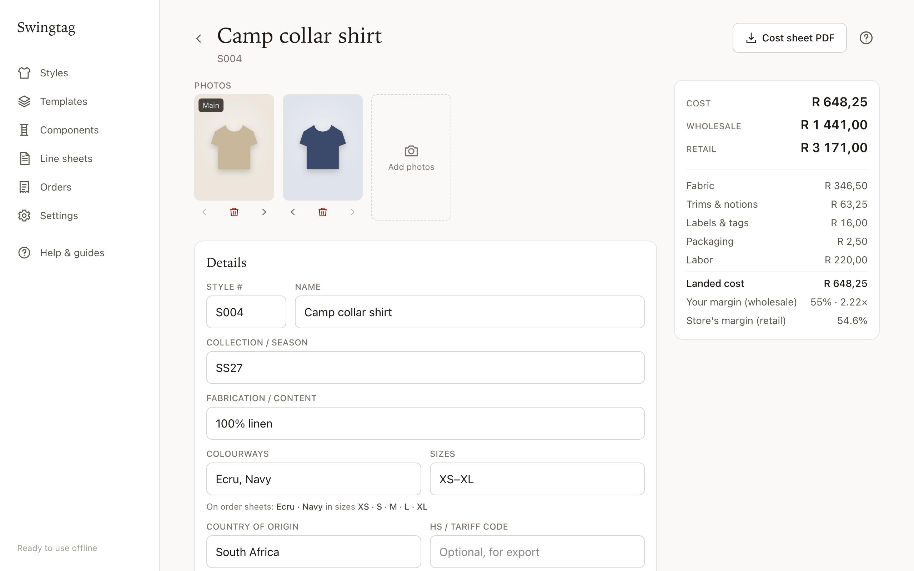
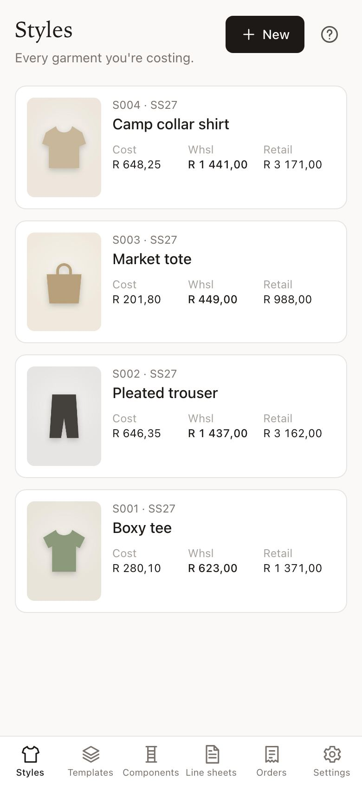
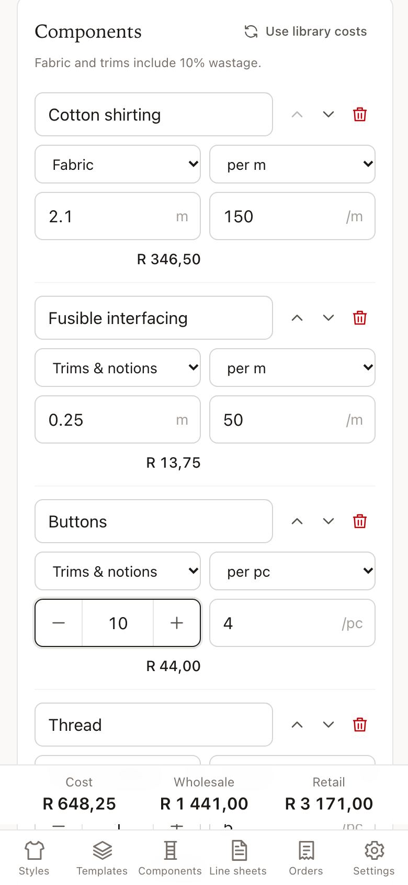
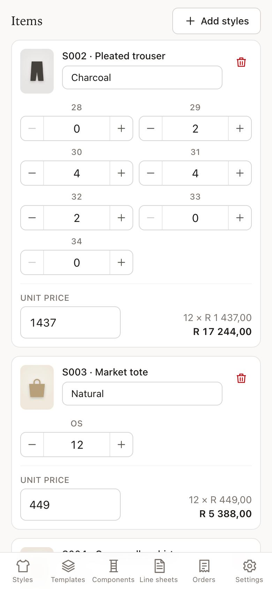
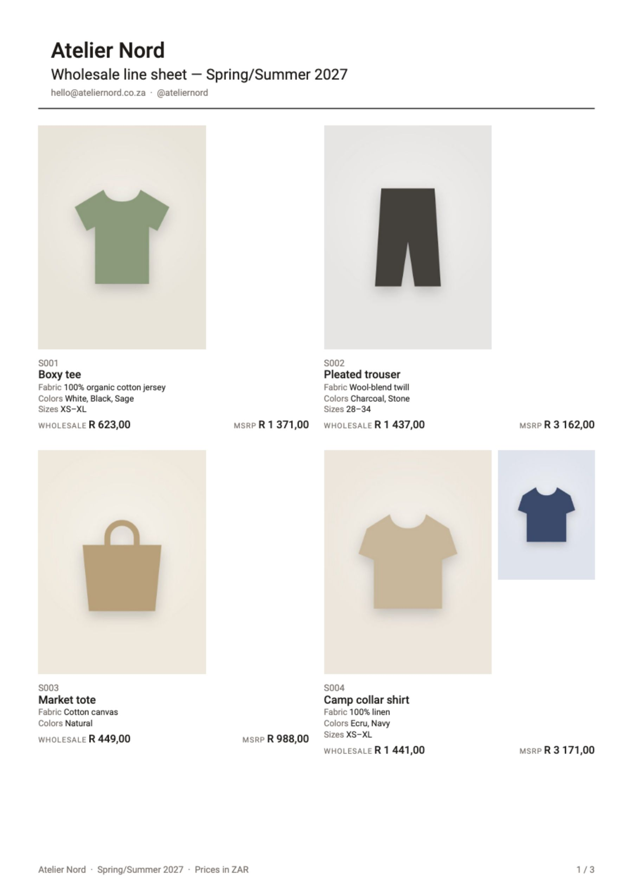
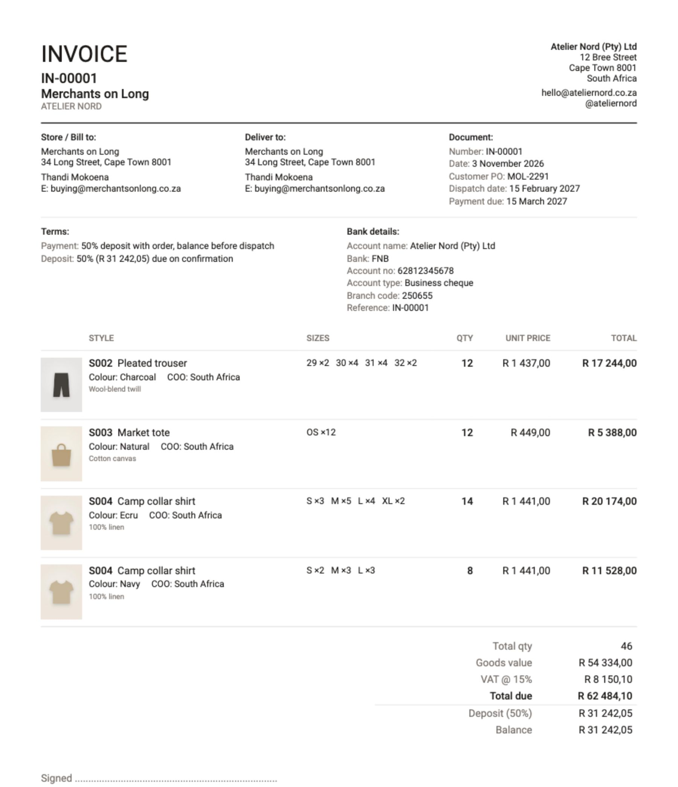

# Swingtag

**Live:** https://garykahn.github.io/swingtag/

Garment costing and line sheets for independent designers. Mobile-first and installable, and works fully offline.
There is no login: all data stays in the browser (IndexedDB), and a JSON backup file moves it between devices.


<p align="center"></p>

| Cost a garment | Quantities with − / + | Enter an order |
| :---: | :---: | :---: |
|  |  |  |

| Line sheet PDF | Invoice PDF |
| :---: | :---: |
|  |  |

There are step-by-step guides with more screenshots in the app under **Help & guides** (the **?** on each page).

## Install it like an app

Open https://garykahn.github.io/swingtag/ once while online, then:

| Device | How |
| --- | --- |
| iPhone / iPad | Safari → Share button → **Add to Home Screen** → Add |
| Android | Chrome → tap **Install** when offered, or ⋮ → **Add to Home screen** (Samsung Internet: ≡ → Add page to → Home screen) |
| Computer (Chrome / Edge) | Click the install icon at the end of the address bar, or Chrome ⋮ → Cast, save and share → Install page as app; Edge … → Apps → Install this site as an app |
| Mac (Safari, macOS 14+) | File → **Add to Dock** |
| Firefox (computer) | Not installable: bookmark it instead. It still works offline |

On iPhone, iPad and Mac Safari, the installed app keeps its data separately from the browser, so install before you
start, or move your work across with Settings → Export / Import backup. The in-app guide (Help → Install) opens on the
right instructions for the device you're using, and offers a one-tap Install button where the browser supports it.

## Features

- **Components**: a library of fabrics, trims, labels, packaging and labor with unit costs
- **Templates**: built-in garment types (T-shirt, button-up shirt, trousers, skirt, dress, hoodie, jacket, tote) plus your own
- **Styles**: cost a garment from a template, add photos, and get wholesale (from a target margin) and retail (from a multiplier) prices, with rounding and per-style overrides
- **PDFs**: an internal cost sheet per style and a wholesale line sheet (2-up, 3-up or list) with your brand and order terms
- **Orders**: tap in quantities per size and colour (or import a buyer's filled-in order sheet), then download an
  invoice, pro forma or order confirmation PDF with VAT, deposit and your bank details
- **Order sheet (.xlsx)**: from any line sheet, with photos, a yellow qty cell per size and live totals. Opens in Excel,
  Google Sheets (free, any device) and Apple Numbers. A hidden `_costsheet` tab maps cells back so the returned sheet
  can be imported. For buyers who'd rather write it, the line sheet PDF can include a printable order form
- **Units & currency**: metric by default (switchable to yards, converting the library), ZAR by default
- **Backup**: Settings → Export / Import (merge or replace)

## Develop

```sh
npm install
npm run dev          # http://localhost:5173
npm test             # unit tests (pricing math, backup round-trip)
npm run build && npx playwright test   # offline end-to-end test against the production build
```

`node scripts/icons.mjs` regenerates the PWA PNG icons from `public/icons/icon.svg`.

`npm run screenshots` regenerates the screenshots in `public/help/` (used by the in-app guides and this README). It seeds
a demo brand through the real UI, captures the key screens on a phone and a desktop, renders the generated PDFs with
pdf.js, and rebuilds. Guide text lives in `src/help/guides.ts`.

## Deploy

Pushing to `main` runs `.github/workflows/pages.yml`, which tests, builds and deploys to GitHub Pages.

`npm run build` produces a static `dist/` folder with relative paths (`base: './'`) and hash routing, so it runs from any
static host or subpath: GitHub Pages, Cloudflare Pages, Netlify, or plain S3. The host must serve over HTTPS for the
service worker (offline mode and install-to-home-screen) to work.

Participants open the URL once while online. After that it works offline and can be added to the home screen
(iOS: Share → Add to Home Screen).

## Notes

- Pricing: `wholesale = landed cost ÷ (1 − margin)`, `retail = wholesale × multiplier`, both rounded *up* to the
  chosen price point. Wastage applies only to fabric and trims. See `src/lib/pricing.ts`.
- Photos are resized to 1600px JPEGs (plus a 400px thumbnail) before they're stored.
- Safari can evict site data after weeks of no use unless the app is installed to the home screen. The app requests
  persistent storage and shows "last backup" in Settings as a nudge.

## Licence

[MIT](LICENSE) © 2026 Gary Kahn. Free to use, copy and modify.

Swingtag is provided **as is, without warranty**. It does the arithmetic you give it, but prices, margins, VAT and
invoices are the user's responsibility to check. All data stays on the user's device; nothing is sent to a server.

